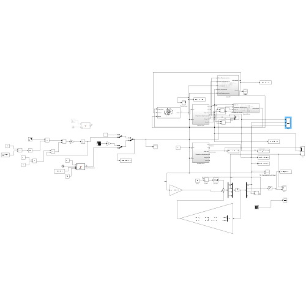
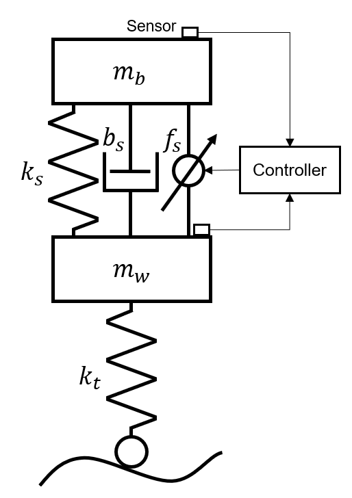
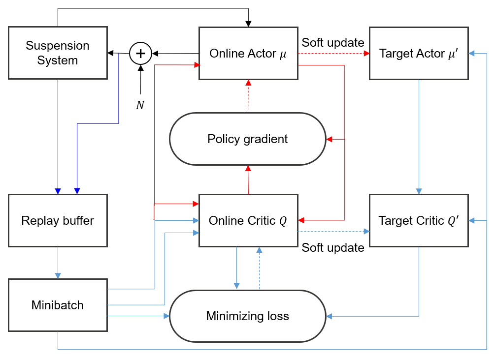
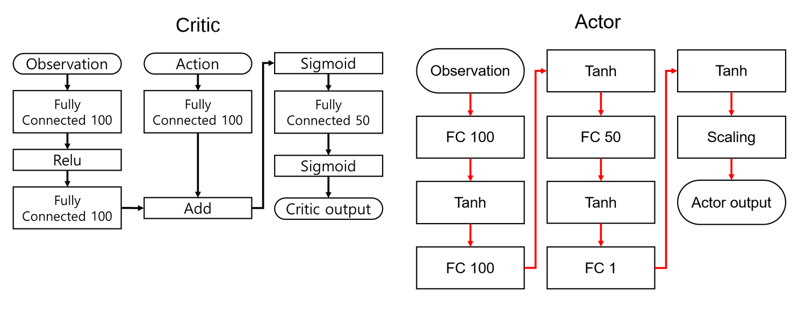
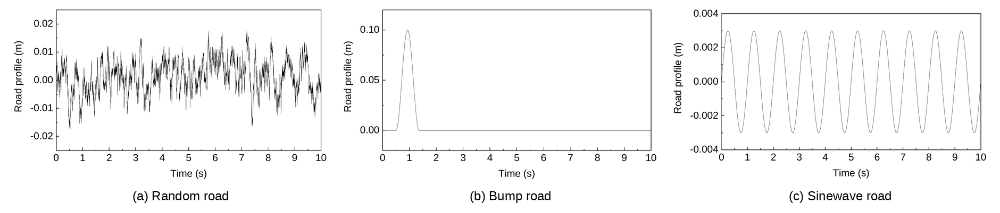
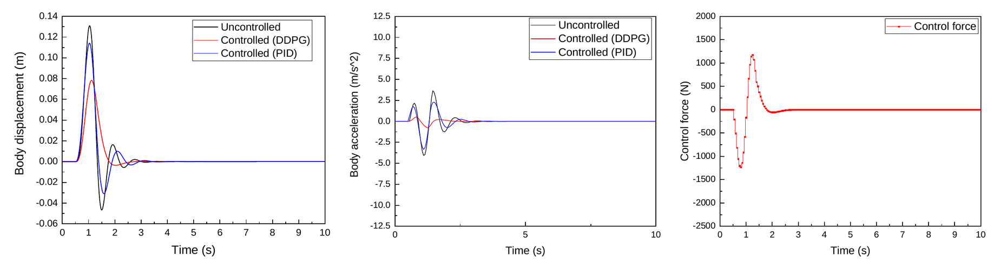
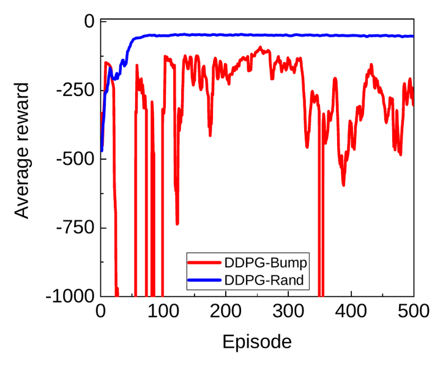
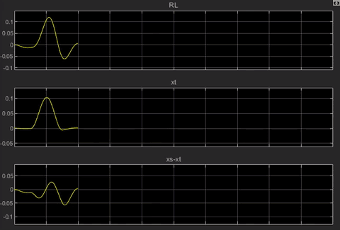

# Reinforcement Learning for Active Suspension Control

A quarter-car active suspension controlled by a reinforcement-learning agent, built in Simulink with the Reinforcement Learning Toolbox.
The same model runs a passive suspension and a PID controller side by side, so the three responses can be compared on identical road inputs.
The repository holds the Simulink models and the MATLAB scripts that create and train the DDPG agent.

  
   
  Overview of the Simulink model: road inputs on the left, the three suspension variants and the RL agent on the right.

## Publications

- D.-G. Yuk, J. W. Sohn, "Active Suspension Control Using Reinforcement Learning," *J. Korean Soc. Precis. Eng.*, 41(3), 223–230, 2024. https://doi.org/10.7736/jkspe.023.141
- Conference presentations: KSNVE Spring Conference 2023, KSME Annual Meeting 2023.

## Repository structure

| Path | Purpose |
|---|---|
| `simulink/quartercar_RL_6_no_G.slx` | Quarter-car model with the RL agent, the PID and passive baselines, road-input generators and the reward block |
| `simulink/DDPG_quartercar_6.m` | Creates the DDPG agent and trains it on `quartercar_RL_6_no_G` |
| `simulink/quartercar_RL_6_no_G_last.slx` | RL loop only, on a state-space form of the plant, with the road inputs grouped into subsystems |
| `simulink/DDPG_quartercar_6_last.m` | Creates the DDPG agent and trains it on `quartercar_RL_6_no_G_last` |
| `simulink/quartercar_PID_Passive.slx` | State-space plant with a switch between the PID controller and the passive case |
| `analysis/untitled.m` | Converts the logged time series to timetables and plots the responses |
| `analysis/untitled3.m` | Post-processing snippets: Welch power spectral density, area under the PSD and RMS of the logged responses |
| `archive/DDPG_quartercar_6_control_input.m` | Earlier training script (September 2023) |
| `archive/quartercar_RL_6_no_G_control_input.slx` | Earlier RL-only model that the archived script trains on |
| `docs/` | Figures used in this README |

## How it works

- The plant is a two-mass quarter-car model (sprung body, unsprung wheel) with a spring–damper suspension and a tire spring.
- The RL agent outputs the actuator force between the body and the wheel.
- The agent observes four signals: body acceleration, suspension displacement, body velocity, and body velocity minus tire velocity.
- The reward is computed in the `reward2` subsystem as the negative sum of the weighted terms listed below, multiplied by `Rho 5`.
- The same subsystem raises `isdone` when the absolute body–wheel deflection exceeds a constant.
- Road inputs are selectable with manual switches: a half-cosine bump defined by height, length and vehicle speed, a random road generated from band-limited white noise, a sine wave, and a step.
- The model also contains a PID-controlled copy of the plant in state-space form and a passive (uncontrolled) copy, and logs all three responses to the workspace.
- The training scripts wrap a model with `rlSimulinkEnv`, build a Q-value critic and a deterministic actor, create an `rlDDPGAgent`, and call `train`.

Plant parameters as set in the model:

| Parameter | Symbol | Value |
|---|---|---|
| Sprung mass | `Ms` | 365 kg |
| Unsprung mass | `Mu` | 43 kg |
| Suspension stiffness | `ks` | 24,000 N/m |
| Suspension damping | `bs` | 2,126 N·s/m |
| Tire stiffness | `kt` | 243,000 N/m |
| PID baseline gains | `P`, `I`, `D` | 0.8, 0.1, 0.5 |
| PID output limits | | −4000 to 4000 |

Reward terms in `reward2` of `quartercar_RL_6_no_G.slx`:

| Term | Block | Value |
|---|---|---|
| (body displacement − wheel displacement)² | `Rho 3` | 1000 |
| (wheel displacement − road displacement)² | `Rho 2` | 100000 |
| (body acceleration)² | `Rho 1` | 1 (block default) |
| (control input delayed by one step)² | `Rho 4` | 0 |
| `isdone` flag | `Gain` | −500 |
| Scaling of the summed terms | `Rho 5` | 1 (block default) |
| Threshold on the absolute body–wheel deflection for `isdone` | `Compare To Constant1` | 1000 |

Road inputs in `quartercar_RL_6_no_G.slx`:

| Road input | Source | Settings |
|---|---|---|
| Bump | `MATLAB Function2` (half cosine) | height 0.1 m, length 3.6 m, speed 4.1666667 m/s, starting at 0.5 s |
| Random | `Band-Limited White Noise1` fed through an integrator loop | noise power 5.4e-3, sample time 0.1 s, seed 23341 |
| Sine | `Chirp Signal` with equal initial and target frequency, scaled by `Gain` | 1 Hz, gain 0.003 |
| Step | `Step` | block defaults |

Settings that differ between the training scripts:

| Script | Model | Observation size | `Ts` | `Tf` |
|---|---|---|---|---|
| `simulink/DDPG_quartercar_6.m` | `quartercar_RL_6_no_G` | 25 | 0.05 s | 10 s |
| `simulink/DDPG_quartercar_6_last.m` | `quartercar_RL_6_no_G_last` | 4 | 0.005 s | 10 s |
| `archive/DDPG_quartercar_6_control_input.m` | `quartercar_RL_6_no_G_control_input` | 4 | 0.05 s | 5 s |

Settings shared by the training scripts:

| Setting | Value |
|---|---|
| Agent | DDPG (`rlDDPGAgent`) |
| Action | one continuous value named `Control force`, limited to −4000 to 4000 N |
| Observation limits | unbounded |
| Critic, observation path | fully connected 100 → ReLU → fully connected 100 |
| Critic, action path | fully connected 100 |
| Critic, common path | addition → sigmoid → fully connected 50 → sigmoid → fully connected 1 |
| Actor | fully connected 100 → tanh → fully connected 100 → tanh → fully connected 50 → tanh → fully connected 1 → tanh → scaling by the upper action limit |
| Critic learning rate, gradient threshold | 1e-3, 1 |
| Actor learning rate, gradient threshold | 1e-4, 1 |
| Experience buffer length | 1e6 |
| Discount factor | 0.99 |
| Mini-batch size | 64 |
| Exploration noise variance, variance decay rate | 0.6, 1e-5 |
| Maximum episodes | 5000 |
| Maximum steps per episode | `ceil(Tf/Ts)` |
| Score averaging window | 5 episodes |
| Stop criterion | average reward of −5 |
| Agent saved when | episode reward reaches −100 |
| Random seed | `rng(0)` |

Signals logged to the workspace by `quartercar_RL_6_no_G.slx`:

| Variable | Meaning |
|---|---|
| `body_displacement`, `body_acc` | Response with the RL agent |
| `pid_displacement`, `pid_acc` | Response with the PID controller |
| `passive_displacement`, `passive_acc` | Response of the passive suspension |
| `road_displacement` | Road input |
| `control_force` | Actuator force from the RL agent |
| `reward` | Reward signal |

## Figures

<table>
  <tr>
    <td align="center" width="35%"> Quarter-car model used as the plant, from the manuscript draft (Fig. 4).</td>
    <td align="center" width="65%"> DDPG structure with online and target actor and critic networks, replay buffer and minibatch; the same diagram is on slide 14 of the KSME 2023 slides.</td>
  </tr>
  <tr>
    <td align="center" colspan="2"> Layer layout of the critic (drawing from the manuscript draft, Fig. 3a) and of the actor (drawing from the KSME 2023 slides, slide 18).</td>
  </tr>
  <tr>
    <td align="center" colspan="2"> The three road profiles used in the study, from the manuscript draft (Fig. 5).</td>
  </tr>
  <tr>
    <td align="center" colspan="2"> Bump road at 15 km/h, from the KSME 2023 slides (slide 26): body displacement and body acceleration for the uncontrolled, DDPG and PID cases, and the DDPG control force.</td>
  </tr>
  <tr>
    <td align="center"> Average reward per episode for the agent trained on the bump road (DDPG-Bump) and the agent trained on the random road (DDPG-Rand), from the manuscript draft (Fig. 10).</td>
    <td align="center"> Screen recording of a training run in May 2023 (1.5x speed, cropped): the Simulink scope redraws body displacement (<code>RL</code>), wheel displacement (<code>xt</code>) and their difference (<code>xs-xt</code>) as episodes run.</td>
  </tr>
</table>

## Requirements

- MATLAB with Simulink; the models were saved in R2023a.
- Reinforcement Learning Toolbox (`RL Agent` block, `rlSimulinkEnv`, `rlDDPGAgent`, `train`).
- Deep Learning Toolbox (the layer and `dlnetwork` functions that build the actor and critic).
- A GPU supported by MATLAB with Parallel Computing Toolbox, because the scripts create the actor and critic with `UseDevice="gpu"`.
- Signal Processing Toolbox for `analysis/untitled3.m` (`pwelch`).

## Running

- Run the scripts from inside `simulink/` so that the models are found by name.
- `DDPG_quartercar_6_last.m` creates the agent and trains it on `quartercar_RL_6_no_G_last`.
- Line 12 of `DDPG_quartercar_6_last.m` calls `set_param` on `quartercar_RL_6_no_G`, so that model has to be loaded as well.
- `DDPG_quartercar_6.m` targets `quartercar_RL_6_no_G` but, as last saved, declares a 25-element observation while the `observations` block of that model outputs four signals.
- Line 46 of `DDPG_quartercar_6.m` plots `actorNetwork` before the script defines it on line 51.
- To simulate with a trained agent, load it into the base workspace as `saved_agent`, which is the name the `RL Agent` block reads.
- The active configuration set of the three models in `simulink/` stops the simulation at 10 s.
- Select the road input with the manual switches, run the model, and plot the logged variables.
- The scripts in `analysis/` read the logged signals from the simulation output object `out`.

## Data

- No external dataset is used; all signals are generated inside the Simulink models.
- Trained agents, training logs and result files are not included.

## Notes

- Research code kept as it was used; the files date from 2023 to 2024.
- The training scripts follow the DDPG pendulum swing-up example of Reinforcement Learning Toolbox, and their last lines still name `SimulinkPendulumDDPG.mat`.
- The archived model sets `Rho 2` to 0, reads the agent from a variable named `agent`, and stops at 5 s.
- The figures come from the KSME 2023 slides, the manuscript drafts and a screen recording made during training.
